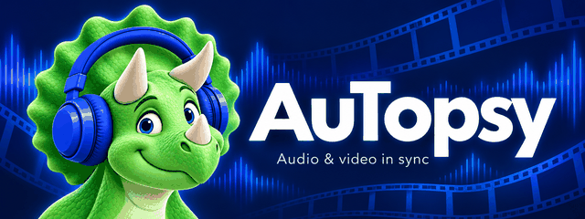

# AuTopsy

<p align="center">
  
</p>

<p align="center">
  <strong>Audio &amp; video in sync.</strong><br>
  Familiar multitrack audio editing, with video on the same timeline.
</p>

<p align="center">
  <a href="#video-tracks-windows-fork">Video guide</a> ·
  <a href="BUILDING.md">Build AuTopsy</a> ·
  <a href="https://github.com/Ceratops-Code/AuTopsy/issues">Report a problem</a> ·
  <a href="CONTRIBUTING.md">Contribute</a> ·
  <a href="LICENSE.txt">GPL license</a>
</p>

**AuTopsy** is an independent, open-source audio and video editor for Windows,
forked from [Audacity's `audacity3` branch](https://github.com/audacity/audacity/tree/audacity3).
It is maintained by [Ceratops-Code](https://github.com/Ceratops-Code).

| Picture | Sound | Timeline |
| --- | --- | --- |
| Multiple video tracks, filmstrip clips, split, trim, and cross-track moves | Import each video's soundtrack into separate editable audio tracks | Keep picture and sound together in one scrolling track pane |
| Smooth, lightweight preview with a separate player window | Mix, mute, add effects, or replace the original soundtrack | Save edits in your project; export MP4 or MKV with the finished mix |

AuTopsy also adds persistent audio clip groups and audio/video track insertion
before or after an existing track. Its green Trixie mascot wears blue headphones.

The audio engine and its established editing tools come from Audacity:

- **Recording** from any real or virtual audio device that is available to the host system.
- **Export / Import** a wide range of audio formats, extensible with FFmpeg.
- **High quality** using 32-bit float audio processing.
- **Plugin Support** for multiple audio plugin formats, including VST, LV2, and AU.
- **Macros** for chaining commands and batch processing.
- **Scripting** in Python, Perl, or any other language that supports named pipes.
- **Nyquist** a powerful built-in scripting language that may also be used to create plugins.
- **Editing** multi-track editing with sample accuracy and arbitrary sample rates.
- **Accessibility** for VI users.
- **Analysis and visualization** tools to analyze audio or other signal data.

## Users

Download the Windows installer from [AuTopsy Releases](https://github.com/Ceratops-Code/AuTopsy/releases).

To remove picture edges, right-click a video clip and choose **Crop Picture...**.
Set the left/top/right/bottom percentages, or use **Reset Crop**. The source
footage stays available, and crop follows the clip through saved projects and
ordinary editing. Automatic export dimensions follow the cropped picture, so
cropping does not restore the removed area as black borders. Explicit output
dimensions still fit the picture inside the chosen frame. Export uses one frame
clock across cuts and speed changes to keep the edited picture aligned with the
project's audio mix.

Right-click an audio clip for **Clip Volume...** to raise or lower that clip's
level in dB using the native Amplify dialog, with normal Undo/Redo. **Export
Clip...** selects the clicked audio clip before opening export, with **Current
Selection** already chosen, including when there was no previous selection.
Mute or solo exclusion does not switch its range to Entire Project; the native
exporter reports inaudible audio separately. Video clip export
uses its picture and everything audible in the project over that clip's original
time span. The edit cursor extends through the full track pane.

To move individual clips together, click the first clip and **Ctrl-click** each
additional audio or video clip, then drag any selected clip's header. Ctrl-click
again to remove a clip from the temporary move selection. The set keeps its
relative timing, includes existing linked/grouped partners, and stops together
at a collision. One Undo reverses the drag; Escape cancels it. A plain click on
another clip replaces the set; a waveform/blank range click clears it. Shift-drag
keeps the usual whole-track behavior. This temporary selection applies to
movement and is not saved or turned into a persistent group; range edits still
use the ordinary time selection. **Ctrl-drag a clip header** to move between
compatible tracks while keeping its exact time, even if the pointer drifts
sideways. Ctrl-click without dragging still toggles the temporary selection.

Ordinary Record starts at the cursor. For existing recording tracks, an occupied
start is rejected and the take stops at the next clip or an earlier selected
end. The recording-gap policy has focused automated coverage; this preview has
not been checked against microphone hardware.

The main transport uses the original 52-pixel buttons. **Go to Cursor** brings the
current playhead into view during playback or pause, or the edit cursor when
stopped, without changing zoom, selection or project content.

Select several tracks, then use **Tracks > Track Groups > Group Selected
Tracks...** or their track menu. The group arrow collapses its members into one
summed-audio waveform; expanding restores the individual editable tracks. Track
gain, pan, mute and clip envelopes contribute to that waveform. It describes the
member audio before real-time effects. Opposite signals cancel in the summary.
Clicking the header selects its members. Drag the header, or use the normal track
move commands, to move the whole group. **Ungroup Tracks** and the header's **x**
remove the grouping while keeping the member tracks and audio. Groups are flat.
Ordinary audio stays in standard AUP3 tracks, so stock Audacity opens it without
the optional group headers.
Local deployments use the installer, including locally built releases; source
and build directories are not installation inputs. A local installation runs from
`%ProgramFiles%\AuTopsy\AuTopsy.exe`. See the video guide below for picture editing
and [AuTopsy issues](https://github.com/Ceratops-Code/AuTopsy/issues) for support.
The inherited audio tools are covered by the
[upstream Audacity manual](https://manual.audacityteam.org/).
The video extension is currently Windows-only; other platforms retain the
upstream audio build. Video source files stay external to the saved project.
To locate a moved source, stop playback, choose **File > Relink Video Media...**,
select the old source and then its replacement file. Clip positions, trims and
links are retained; the already imported audio remains independently editable.

Projects use standard **`.aup3`** storage. The focused compatibility test opens
AuTopsy projects in unmodified Audacity **3.7.8** and **3.7.9**, checking audio
clips and labels while video tracks are skipped, then stock save/copy/reopen.
Tests download pinned official portable packages automatically; no installed
Audacity is required by either AuTopsy or this test. Saving in Audacity drops
AuTopsy's video, links, clip groups and flags; keep the original AuTopsy project
when those additions matter. Compatibility with unreleased Audacity versions
cannot be guaranteed.

Project writes use SQLite's durable WAL commits, including autosaves. Saved
copies keep rollback journaling enabled and report a failed disk commit instead
of claiming the copy succeeded. These changes preserve the AUP3 format. Storage
must honor flush requests, and a project that is still open may need its `-wal`
file as well as the main `.aup3`; use **Save Project > Backup Project** for a
self-contained copy rather than copying the live main file alone.

Preview publication uploads the completed installer and its source/build-check
manifest. The publisher keeps the original accepted build intact, checks the
uploaded asset identities, and makes the preview public after both uploads.
See [BUILDING.md](BUILDING.md) for the build and publication inputs.

## Code signing policy

Current Windows preview installers are **unsigned**. AuTopsy is preparing an
application to SignPath Foundation; no certificate or sponsorship has been
granted, and a signature must never be claimed for an unsigned file.

- Author, reviewer and release/signing approver:
  [RomanOstr](https://github.com/RomanOstr).
- Contributions from other authors require maintainer review. Release signing
  requires the maintainer's explicit approval of the exact source revision
  and its GitHub-hosted installer artifact.
- Signing accounts and repository access must use multi-factor authentication.
  Signing credentials belong in protected service/GitHub secrets, never source
  files, release assets or build logs.

Once signing is available, each release will identify its signing provider and
publisher. If SignPath Foundation accepts AuTopsy, this policy and release pages
will credit SignPath.io and SignPath Foundation before the first signed release.
Unsigned previews remain clearly labelled.

The video preview, proxy preparation and edited-audio export process media
locally. Their source videos and project audio are not uploaded by those
features. The Windows release build disables inherited application networking;
opening help or repository links uses the user's browser. Installed components
can be removed using Windows Installed Apps.

## Development design

[The design](docs/design.md) describes the planned editing model, native adapter
boundaries and preview/export contracts. The detailed product backlog is
maintained outside this source repository.

## Developers

See [the AuTopsy build instructions](BUILDING.md).

See [CONTRIBUTING.md](CONTRIBUTING.md) for AuTopsy contributions and
[upstream development documentation](https://audacity.gitbook.io/dev/) for the
inherited audio engine.

The SDLC contract in `sdlc/sdlc.yml` owns the same checks used locally and in CI.
It runs the independent C++ feature tests with CMake/CTest, alongside headless
screen-selection and worker-lifecycle cases. CMake owns the disposable
`.build/_core` cache and updates it in place on each call; installers are separate
release outputs. Python lint covers the fork's test driver and repository tools;
inherited scripting examples retain their upstream conventions.
The shared test harness in `scripts/piped-work/run_fork_test_harness.py` owns
child-process handling, display confinement, media fixtures and GUI gestures;
`test_fork_features.py` dispatches the feature scenarios and owns result records.
`test_video_clip_edits.py` owns focused split-seam, Heal/Join/Separate,
video track Mute/Solo, individual clip picture mute and multi-source
rendering/relinking cases. `test_video_transport.py` owns preview-window helpers,
transport and keyboard-navigation cases, and preview pixel observations. Native
result identities retain the exact modules that earned each pass. `fork-video-speed` covers linked retiming, repeat
requests, Undo/Redo, canceled edge gestures, source handles, flags, joins, native
audio pitch and decoded preview/export timing. Project interoperability includes
a retimed joined clip and its stretched native audio. `fork-video-speed-storage`
separately covers native save/reopen so a window-lifecycle failure cannot hide
editing or rendering results.
`fork-video-clip-storage` checks repeated native round trips of two joined clips
containing 16,384 retained pieces. The separate-clip and retained-tree bounds
are independent; the reader and editing model share those limits.
`fork-video-parent-links` separately checks manually linking previously unlinked
joined content, both trim edges, differing audio/video placements, speed,
repeated requests, Undo/Redo and native save/reopen.
`fork-video-transport` covers the actual preview buttons, pause/resume, live
picture mute, video-only playback and ownership between projects.
`fork-transport-toolbar` covers native button dimensions, canceled clicks,
repeated cursor navigation in both directions, playback/pause and unchanged
selection, zoom and history.
`fork-preview-navigation` covers preview timeline seeks, canceled/repeated drags,
focused arrow keys, paused frame steps, playback volume and resume.
`fork-track-groups` covers grouping, phase-aware summed waveforms, repeated
Undo/Redo, native collapse controls, saved identities and stock Audacity readers.
`fork-video-visibility` covers track buttons and cancellation, Undo/Redo,
clipboard/save/reopen, visible source selection and decoded picture/audio exports.
The focused `fork-video-selection`, `fork-video-edges`, `fork-video-clipboard`
and `fork-video-track-menu` cases exercise real clip clicks,
double-click selection, Delete/Backspace, reversible edge drags, canceled edits,
right-click clipboard actions in clips and gaps, and the common **Add track...**
submenu. `fork-video-linked-edges` separately checks both trim directions
with the default linked video/audio import. These cases use only generated
media and the owned test process.
Preview tests generate their own neutral 16-second colour-pattern video and
tone; personal video inputs are not accepted. `fork-fixtures` checks that media
without opening AuTopsy.
The native case catalogue belongs to `test_fork_features.py`; CMake reads it
through `--list-native-cases`, so adding a scenario does not rebuild the editor.
`fork-video-vfr-export` checks real alternating frame durations with independent
flash/click cues, split seams, crop and repeated decoded exports.
`fork-video-encoder-boundaries` checks failed requests without overwriting an
existing destination. It probes actual NVENC use: an unavailable driver earns
only rejection/cleanup coverage, never a hardware-encoding pass.
`fork-preview-soak` targets sustained playback with 32 linked clips and a
six-hour timeline offset, measuring clock response, loop continuity, memory,
handles and the retained playback timing samples. These machine-specific
measurements are separate from the portable models.
Physical capture is opt-in: `fork-cursor-recording` is listed only when
`AUTOPSY_TEST_RECORDING_DEVICE` names an exact input device. It checks gap limits,
early stop, repeated capture and Undo/Redo. The harness closes the private editor
before deleting the captured project, samples and SQLite companions; only device
capabilities and clip geometry enter its receipt. See [BUILDING.md](BUILDING.md).
`fork-project-compatibility` separately exercises a private stock Audacity 3
consumer with generated projects and compares their rendered audio. See
[BUILDING.md](BUILDING.md) for its explicit consumer input.
Inherited upstream CTest suites remain available in a full application build;
the default fork CI selects the owned portable checks rather than running the
entire upstream platform matrix. GitHub's CodeQL default setup scans C++, Python
and Actions. This fork has no SonarQube job.
The npm overrides select patched lint dependencies while their parent packages
still constrain older releases.

## Manual upstream updates

The product branch is `main`. `origin` is
`https://github.com/Ceratops-Code/AuTopsy.git`; `upstream` is
`https://github.com/audacity/audacity.git`.
Use **`upstream/audacity3`** when reviewing upstream changes. Upstream updates
are deliberately manual; no scheduled synchronization or automatic merge is enabled.

```sh
git remote add upstream https://github.com/audacity/audacity.git  # once per clone
git fetch upstream audacity3
```

Review the incoming changes, merge the selected update on a task branch, and
run the relevant checks in [BUILDING.md](BUILDING.md) before publishing it.
The feature-owned video and clip-group modules keep upstream integration narrow.

## License

AuTopsy is distributed under **GPLv3**, retaining Audacity's copyright notices,
credits, and Git history. Most inherited source files are GPLv2-or-later;
third-party components and VST3-related code have their own notices.
Documentation is CC-BY 3.0 unless otherwise stated. See [LICENSE.txt](LICENSE.txt)
and the notices accompanying each component.

Audacity is a registered trademark of its respective owner. AuTopsy is an
independent fork and is not an official Audacity release. Upstream names in
credits, license notices, compatibility identifiers, and technical references
identify their original projects.

## Video tracks (Windows fork)

This fork follows upstream's audacity3 branch and adds native video tracks in
the same scrolling track pane as audio. Each track can hold clips from several
files. A separate, resizable preview window shows the composed picture; higher
visible tracks take precedence and gaps expose the tracks below.

AuTopsy has its own Windows instance lock, settings directory, and scripting
pipes, so it can run alongside an installed copy of Audacity.

1. Choose **File > Import > Video...**, the first import entry. Each import
   adds a video track; **Tracks > Add New > Video Track** adds an empty one.
2. Its soundtrack is imported into new audio tracks at its original timing,
   without music tempo matching. Picture and soundtrack clips start linked:
   moving, splitting, or trimming either keeps their linked partners together.
   Use **Edit > Clips > Unlink Video / Audio Clips...** for independent edits.
   Edit, mute, or delete audio normally. Silent videos add no audio tracks.
3. Use **Play**, **Pause** and **Stop** in the preview or the main transport.
   The themed buttons match the main transport; **Pause** also resumes. Both windows control the same
   project audio/video playback; preview controls do not interrupt recording or
   another project's stream. Video follows normal-speed playback, pause, stop,
   timeline seeks and loop jumps. Audio plays once through the editable tracks.
   The preview timeline seeks picture and sound together, retaining playback or
   pause. Dragging commits on release; **Escape** cancels an unfinished drag.
   With preview focus, **Left/Right** always seek one second, including while
   paused or playing. **−1 s / +1 s** do the same. **Up/Down** and the preview
   volume slider control the same playback volume as the main window.
   **Previous frame / Next frame** retain precise source-frame inspection.
   Select a time range, then enable **Loop selection** to repeat it while editing.
   **Quality** offers Auto (smooth), 360p, 720p, 1080p and Original. This choice
   belongs to the current preview session; changing it preserves position and
   transport state. Export always uses original media.
4. Closing the preview hides it. **View > Video Preview** shows it again, and
   starting playback also brings it back. Delete a video track using its normal
   close button or **Tracks > Remove Tracks**.
5. Choose **File > Export Video with Audio Mix...** to save MP4 or MKV.
   Auto copies unchanged picture without re-encoding, including adjacent
   splits. Edited picture defaults to H.264. The export dialog also offers HEVC,
   AV1, and NVIDIA H.264/HEVC, with resolution, frame rate and quality controls.
   NVIDIA presets require compatible hardware and drivers. Zero dimensions and
   frame rate keep the first visible source's oriented size and rate; other
   sources are scaled and letterboxed. The entire project mix replaces
   the original soundtrack, including mute, solo, gain, pan and effects.
   Export starts at zero and ends at the last video clip; short audio is padded
   with silence and later audio is excluded. The current selection does not
   limit this export. Audio is stereo AAC at 48 kHz, 256 kbit/s.

Each video track has visible **Mute** and **Solo** buttons, also available in
its track menu. They affect picture in both preview and export; the separate
audio tracks keep their own mix settings. Several video tracks can be soloed.
Video Mute overrides Solo, and a solo track's gaps remain black unless another
solo track supplies picture there. Visibility changes support Undo/Redo and
save/reopen. Hiding the final picture leaves a black tail; hiding every video
exports black for the full video duration with the edited audio mix. Export does
not need to open muted sources.
Right-click an individual video clip and choose **Mute Clip** to hide only its
picture. Its grey header shows **[Muted]**; lower video layers show through and
its separate audio keeps playing. **Export Clip...** produces black picture with
the audible project mix when that clip is muted, retaining its saved output size
even if the hidden source is offline. Stop playback before changing this clip property.
Copy, split, Join/Separate, Undo/Redo and save/reopen retain the setting. Muting a
joined clip hides all its pieces; separating it keeps those pieces muted.

New imports retain their original display size, including quarter-turn rotation.
For an older project without saved dimensions, choose an explicit export resolution
when all video is hidden.

Playback uses the normal audio transport, including when the soundtrack has
been deleted. Video-only projects supply silence in memory to its clock; no
hidden audio track or temporary soundtrack is created.

Drag a clip's header along the timeline or onto another video track with free
space. Drag either edge to trim it; a single click places the cursor at that
time, and a double click selects just that clip. Delete also removes the clip
under a point cursor when its video track alone is selected.
Use the normal **Edit > Clips > Split**, **Split New**, **Trim**, Cut, Copy,
Paste, Delete, and Duplicate actions. Right-click a clip for its editing menu.
Selecting a middle section and pressing **Delete** leaves a gap in both picture
and sound; later clips stay where they are. **Edit > Ripple Delete (Close Gap)**
is available when you deliberately want later material to move earlier.
**Clip Properties...** in either clip menu offers precise Start, End, Duration,
Speed and a timing lock. End/Duration retime the clip; dragging edges trims it.
**Close Gap Before Clip** moves the clip and its linked media to the preceding
clip boundary. Movement snaps to nearby edges and the cursor/selection;
hold **Alt** during a drag to bypass magnetic snapping.
Splits and video moves snap to source frames. Linked splits create separate
left and right groups, so moving the right pair leaves the left pair in place.
Each paste or duplication creates an independent linked set.
Right-click a video clip and choose **Change Clip Speed...** to enter a playback
percentage (1–10000%). Its start stays fixed; linked video and audio retime
together with the host's pitch-preserving audio stretch. Flags, hidden trim
handles and joined content are retained. The clip header shows its percentage.
An overlapping linked result is rejected without changing any clip. Undo/Redo,
preview, frame stepping, saved projects and exports use the same time mapping.
Scripts can use **SetVideoClipBounds** with a persistent clip **Id**, optional
**Track**, and **Start**/**End** project times to trim or restore either edge.
It uses the same linked-media operation as dragging a video edge; repeating
unchanged bounds adds no Undo entry. **SetVideoClipSpeed** uses the same clip
identity and a **Speed** multiplier (2 means 200%).
Unlink clips when synchronizing picture and sound independently. Tracks can be resized, reordered,
scrolled, selected, renamed, and removed with the native controls.

Right-click a video clip and choose **Crop Picture...** to drag frame handles or
enter exact margins. Cancel leaves the picture unchanged. **Fade Picture...**
adds picture fade-in/out in seconds, revealing lower video or black. For a
dissolve, overlap videos on separate tracks and choose **Crossfade from Video
Below...** on the upper clip. These controls preserve clip positions and audio.
Fades remain attached to retained footage through split, trim/untrim and speed
changes, and appear in both preview and export. Preparation can be cancelled
before an edit is applied. **Remove Fades** restores an opaque picture.

**File > Collect Project Media...** creates a new portable folder with
**Project.aup3** and **Media/**. It includes audio and the original footage needed
for every retained video clip, including trimmed handles and joined pieces.
Move the entire folder together. The open project and original files stay intact.
Repeating the same collection into the same destination leaves it unchanged;
choose a new folder after making further edits. A different or damaged existing
archive is never overwritten.

**Edit > Clips > Add Clip Flag...** attaches a short label at the cursor inside
an audio or video clip. Flags follow their clip when it moves, and stay attached
through nondestructive trims, splits, copies, Undo/Redo and project saves.
**Remove Clip Flag...** removes a chosen flag.

Use **View > Previous Video Frame**, **Next Video Frame**, or **Go to Video
Timecode...** for frame placement. Timecode uses HH:MM:SS:FF without drop-frame
numbering; frame inspection reads the original source even when playback uses a
lightweight proxy.

**File > Relink Video Media...** locates moved or missing source videos without
reimporting audio or changing clip positions, trims, links or flags. A replacement
must contain enough source footage for every existing clip. Its preview cache is
prepared before the project references change.

Video tracks own their source references and clip timing. Native TrackList,
clipboard, selection and history adapters provide normal Undo/Redo. Track and
clip data are saved in .aup3 XML and restored without importing another copy
of the soundtrack. Projects from the earlier single-video format open as a
native video track. Source files remain external and must stay accessible.
Cancelling or failing an import keeps existing tracks. Importing picture with
audio is one combined Undo action; removing its picture leaves the audio.

Select touching video pieces and use **Edit > Clips > Heal Video Split** to
remove an accidental seam. **Join** (Ctrl+J) makes one editable clip from selected
pieces, retaining gaps and outer trim handles. **Separate Joined Video** restores
the visible source pieces, including nested joins; untrim first to include fully
hidden pieces. These actions also appear on the video clip's right-click menu.
They preserve clip flags and linked soundtrack movement, support Undo/Redo and
save inside the ordinary project file. Picture joins keep the original
soundtrack clips and samples separate. A gap flag must be moved or removed
before separating its container.

Synchronization uses the audio clock with periodic drift correction;
the preview has no guarantee of frame-accurate external
monitoring. Play-at-speed, scrub, and time-track warping are outside the first
version's smooth-playback scope.

The decoder is [libmpv](https://mpv.io/), loaded from this build's own folder.
Hardware decoding is enabled. Sources above 720p or 60 fps get a silent 540p,
30 fps preview copy during import; edited-audio exports still use the original.
`PrepareVideoPreview.cpp` owns `_video-previews` in the active settings folder.
It groups entries by source path and file identity, retains at most the current
version and two predecessors per source (36 entries total), and protects live
entries with leases. Component startup and completed preparation remove orphaned
builds and prune old entries. Only completed preview/thumbnail pairs are reused.
Picture-transition spans use this same owner, bounded retention and leases.
Only completed picture files are published; cancellation removes incomplete
rendering, and original-quality export uses original footage plus lossless
transition intermediates. Derived transition files are disposable, never project
media to distribute or the authority for saved edits.
Reopening uses an available cache without a nested loading dialog.
`GetVideoPreviewInfo` reports decoded size and a bounded observation of the last
playback, including dropped frames and video/audio clock positions.
Soundtrack import uses Audacity's existing FFmpeg importer with bundled FFmpeg
8.1 shared libraries. Video export uses bundled `ffmpeg.exe` and `ffprobe.exe`; if a source
video codec cannot be copied into MP4, export MKV instead. Export cannot replace
the source video. A cancelled or failed export preserves an existing destination.

The export component owns one temporary `_autopsy-video-export-*` directory
beside the destination, containing `_owner`, `_mix.wav`, optional rendering
instructions in `_filters.txt`, and `_result.mp4` or `_result.mkv`.
`/VideoExport/Workspace` in the active settings profile records
only that directory. Project startup and each export remove abandoned work;
an exclusive owner-file lock protects a live export. Success and cancellation
remove temporary files. Publishing uses one rename on the destination volume.
Each chosen output path holds one current export; completed files belong to
the user and are replaced only when overwrite is allowed. No export log or
version history is produced by the application.

Windows scripting clients use the names
`AuTopsyToSrvPipe` and `AuTopsyFromSrvPipe`.
See [BUILDING.md](BUILDING.md#video-tracks-windows-fork) for the SDK
and focused test commands.

The `ImportVideo: Filename="..."` and
`ExportVideoMix: Filename="..." Overwrite=0` scripting commands invoke the
same operations as the File menu. Set `Overwrite=1` to replace an existing
export; the source video is always protected.

`GetVideoClips` returns native track indices and each clip's source, ID and range.
`SplitVideo: At=2`, `MoveVideoClip: Track=0 Id=2 ToTrack=1 Start=5`, and
`DeleteVideoClip: Track=0 Id=2` use the same editing operations as the native
video controls. Omit `ToTrack` for a move within the source track. Omit `Track`
only when focus or an unambiguous clip ID identifies the track. Empty tracks
can be added through `NewVideoTrack`, `AddVideoTrackBefore: Track=1`, and
`AddVideoTrackAfter: Track=1`. Repeating a split at an existing boundary,
an absolute move to the same start, or deletion of an absent ID makes no change.

With a video track and time range selected, `HealVideoSplit`, `JoinVideoClips`
and `SeparateVideoClips` call the same structural operations. `GetVideoClips`
also reports `joined` and the retained direct `pieces` count for each clip.

## Undo and Redo

Undo and Redo keep the current timeline zoom and scroll position instead of
jumping to the first selected track. Removing tracks can still constrain the
scroll range. Scripting clients can observe the current view using
`GetInfo: Type=View Format=JSON`, which returns `horizontalStart`,
`verticalOffset` and `pixelsPerSecond` without changing the view.

## Audio clip groups and track insertion

The fork adds **Edit > Clips > Group Clips...** and
**Ungroup Clips...**. The chooser can select individual clips across tracks.
Grouping merges any existing groups touched by the choice. A normal clip-header
drag then moves the whole group, including members on unselected tracks, subject
to every track's available space. Group IDs survive project saves and Undo/Redo.
Other audio editing commands keep Audacity's usual selection behavior. Clipboard
copies retain group metadata.

The track menu adds **Add Audio Track Before This Track**,
**Add Audio Track After This Track**, and matching **Add Video Track** before/after
actions. The new empty audio track matches an audio
anchor's mono/stereo channel count; a non-audio anchor creates mono. Each
insertion is one Undo action. The same operations appear under Tracks > Add New,
using the focused track, and as `AddAudioTrackBefore: Track=0` and
`AddAudioTrackAfter: Track=0` scripting commands.

## Upstream integration points

The video timing model in `src/video/EditVideoTimeline.h` uses only standard C++
values. Its split/move/delete and source-time mapping tests run without Audacity
objects. `EditVideoTimeline.cpp` adapts that model to the native project XML,
Undo and command registries. `CreateVideoTrack.cpp` owns the native track,
clipboard, XML, and history adapters. `ShowVideoPreview.cpp` owns the player/clock
and window adapters. `ShowVideoTrack.cpp` supplies the native track view and
mouse controls inside the main scrolling track pane, using the host's time/pixel
mapping and movement contracts. `PrepareVideoPreview.cpp` owns
the leased preview/thumbnail cache. `ExportVideoMix.cpp` adapts native audio export and translates
our picture timeline into FFmpeg filters. Export does not depend on a live
preview window or a native audio-clip implementation.

The video module uses the native importer, audio exporter and command registry.
Its small importer wrapper bypasses music tempo matching. Enabled video builds
keep the numeric runtime locale at C in Windows language setup, as required by
libmpv; the native display separator is captured first.

Clip group storage and commands belong to `src/clip-groups/GroupAudioClips.cpp`;
no grouping API is added to the upstream wave-track utility library. Clip
attachments preserve metadata through XML and Undo copies. The necessary XML
reader hook builds attachment factories before dispatching attributes. The
native movement collector calls one group-expansion adapter, then retains its
ordinary collision rules. Track insertion is a shared native adapter around the
track factory, insertion, focus and history APIs, used by both menu entry points.

The scripting fixes keep command construction and project destruction on the GUI
thread, avoid redrawing closed projects, and defer Quit until its command returns.
Branding keeps upstream internal class and build-target names. The bundled FFmpeg
DLL names identify the supported ABI in the video CMake module. These are the
specific integration points affected by corresponding upstream API changes.

The feature tests use public scripting commands and inspect resulting projects,
audio and video. They do not assert upstream source text, minified names or
unrelated window positions. Changes to a required upstream contract can still
require repair in its adapter; the owned video timing model and its tests have
no dependency on those contracts.
