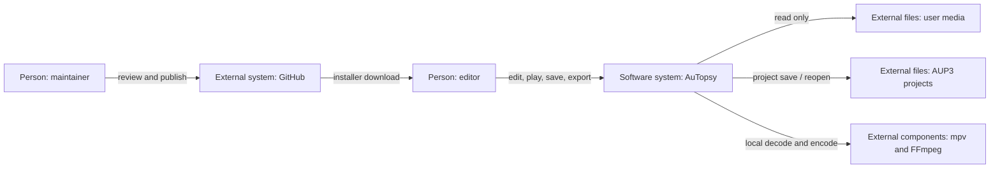
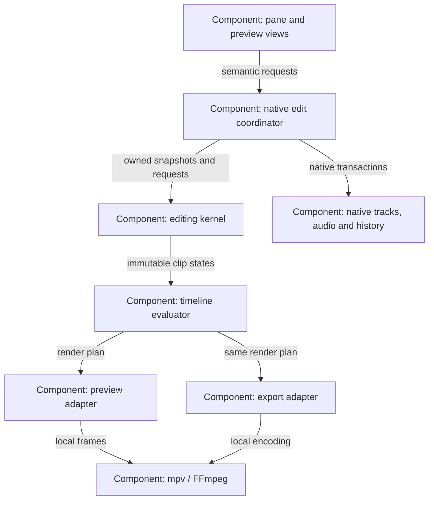
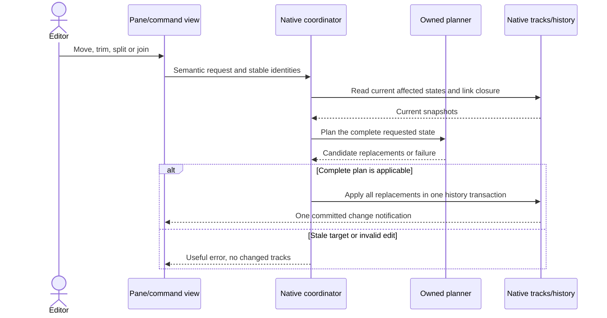
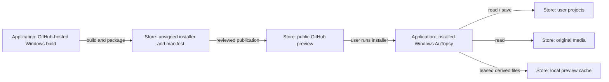

# AuTopsy software design

Status: current implementation plus target architecture. Native clips,
Heal/Join/Separate, preview transport controls, flat-track video Mute/Solo and
per-clip speed and picture crop are implemented in this branch. Embedded-layer
geometry remains an independent foundation awaiting native controls, saved
parent identities and pixel rendering.
Collapsible track groups, native-size transport controls and the preview timeline
and keyboard controls are also implemented.
Other later operations remain targets until their delivery status says otherwise.
Owner: AuTopsy maintainers.

```design-document
{
  "contract_version": 1,
  "document": "docs/design.md",
  "owners": ["AuTopsy maintainers"],
  "source_of_truth": [
    {"path": "AGENTS.md", "role": "upstream independence constraints"},
    {"path": "src/video/EditVideoTimeline.h", "role": "implemented owned timing and composition model"},
    {"path": "src/video/PlanVideoEdits.cpp", "role": "independent batch edit preparation and atomic snapshot publication"},
    {"path": "src/video/EvaluateVideoTimeline.cpp", "role": "independent ordered composition, crop and embedded-layer geometry"},
    {"path": "src/video/CreateVideoTrack.cpp", "role": "implemented native track and persistence adapter"},
    {"path": "src/clip-groups/LinkMediaClips.cpp", "role": "implemented mixed-media editing adapter"},
    {"path": "src/clip-groups/SelectMediaClips.h", "role": "host-free temporary move-selection policy"},
    {"path": "src/video/TestVideoPlayback.cpp", "role": "independent behavior evidence"},
    {"path": "src/video/TestVideoEdits.cpp", "role": "dedicated planner behavior evidence"},
    {"path": "src/video/TestVideoComposition.cpp", "role": "dedicated composition behavior evidence"},
    {"path": "scripts/run_affected_tests.py", "role": "portable test impact map and exact-input result reuse"},
    {"path": "sdlc/sdlc.yml", "role": "local and CI check/build/publication entry points"},
    {"path": ".github/workflows/validate.yml", "role": "hosted build environments"}
  ],
  "update_triggers": ["clip model or persistence changes", "native adapter contract changes", "preview/export semantics changes", "dependency or deployment changes", "operation acceptance or quality measurements"],
  "coverage": {
    "purpose": {"heading": "1. Purpose and priorities", "status": "documented"},
    "constraints": {"heading": "2. Constraints and assumptions", "status": "documented"},
    "context": {"heading": "3. System boundary", "status": "documented"},
    "strategy": {"heading": "4. Strategy and decisions", "status": "documented"},
    "building_blocks": {"heading": "5. Components and ownership", "status": "documented"},
    "runtime": {"heading": "7. Editing and playback sequences", "status": "documented"},
    "deployment": {"heading": "10. Builds and operation", "status": "documented"},
    "data": {"heading": "6. Owned data model and persistence", "status": "documented"},
    "interfaces": {"heading": "8. Adapter and rendering contracts", "status": "documented"},
    "protection": {"heading": "9. Failure containment and owned files", "status": "documented"},
    "decisions": {"heading": "4. Strategy and decisions", "status": "documented"},
    "quality": {"heading": "11. Quality targets", "status": "unverified", "reason": "Targets are proposed; the listed performance, long-run and future-operation measurements have not been completed."},
    "risks": {"heading": "13. Risks and remaining decisions", "status": "documented"},
    "glossary": {"heading": "14. Glossary and references", "status": "documented"},
    "verification": {"heading": "12. Behavior evidence and delivery", "status": "documented"},
    "governance": {"heading": "1. Purpose and priorities", "status": "documented"}
  }
}
```

## 1. Purpose and priorities

AuTopsy is a GPL audio/video editor fork. Users need picture clips to behave as
ordinary editable objects beside audio, including joins, trims, retiming,
relationships, flags and visibility. The complete requested operation inventory
is maintained outside the source repository; this document records architectural
scope and the README is the user entry point.

This document serves maintainers implementing that inventory and reviewing
upstream updates. Readers need basic clip/timeline terminology; no knowledge of
Audacity class layouts is assumed. Its priority order is full requested behavior,
correct mixed-media timing/history, smooth ordinary playback, then independence
from upstream internals. Independence is not permission to omit functionality.

The maintainer owns this document. Implementation and behavior evidence establish
current facts; this document establishes the proposed structure, not a claim that
unbuilt features exist. Backlog status changes only when the corresponding behavior
is delivered. Changes to model, persistence, commands, interfaces, dependencies,
builds or quality measurements trigger a review of affected sections and views.
Do not maintain a second architecture or operation inventory in the README.

## 2. Constraints and assumptions

Imposed constraints:

- Preserve upstream history, GPL licensing, attribution and manual upstream updates.
- Keep video domain state/logic in owned modules behind narrow native adapters,
  following [AGENTS.md](../AGENTS.md). Reuse native track, clipboard, transport and
  history contracts; do not invent a second audio editing engine.
- Video lives in the main scrolling track pane. The separate preview is a view,
  not another authoritative timeline. Import sound into separate editable tracks.
- Preview and export must agree about source mapping, visibility and composition.
- Publish/install completed installers; source directories are not installations.
- Current work must not stop or replace the user's occupied installation.
- Tests use generated neutral footage. No personal video or private project is
  an input to builds, publication, artifacts or automated tests.
- Introduce no new database. Use the existing native project and owned values.

Assumptions requiring evidence: the current native extension registries remain
usable (owner: adapter tests); the mpv fast path can retain ordinary-playback
performance (owner: measured preview cases); more complex compositions can be
prepared fast enough (owner: the complex-preview spike before advanced features).
Existing clip times use doubles and nominal source FPS; they do not prove exact
variable-frame-rate navigation. VFR needs source presentation timestamps.

## 3. System boundary



**System-context view — one AuTopsy installation.** Boxes name people, systems,
components or files; arrows name the interaction. GitHub builds/distributes the
product; local media processing does not upload the editor's content. User media
is untrusted input to bundled decoders. Project save and export are separate
effects; exporting does not change the project's sources.

## 4. Strategy and decisions

Current code already owns plain C++ timing/clip values and native adapters.
Extend this separation into an editing kernel rather than adding independent
behavior to each menu, mouse handle and renderer. Reuse the existing source model
during staged adoption, with one authoritative saved representation at a time.

Use independently testable modules within the desktop process. The useful part
of a service-like design is explicit ownership and replaceable contracts; a
network boundary is unnecessary for local edit planning and adds latency,
packaging, protocol compatibility and partial failure to every gesture. Keep
decode/proxy/export workers separate where crashes, cancellation or resource
limits justify it. Do not introduce RPC, a service registry or separate mutable
project stores merely to resemble microservices.

The kernel accepts owned snapshots and opaque identities and returns complete
plans. Narrow adapters alone translate native tracks, selection, audio transport,
history, project storage and media metadata. Prefer semantic extension points to
class-layout assumptions; reject missing or ambiguous contracts. A changed native
API should require adapting that boundary, while the host-free behavior cases
still compile. Contract versions change deliberately when semantics change; an
interface cannot promise immunity to every future product requirement.

| Decision | Status and reason | Alternative and tradeoff |
| --- | --- | --- |
| Owned editing kernel, native adapters | Target. Upstream pointers, track classes, XML hooks and commands stay at boundaries. | Reusing native audio clips as fake picture containers couples video to sample storage and audio-only transformations. |
| Content separate from placement | Implemented for joins and affine retiming: immutable retained content and an independent visible window. | A single media tuple cannot represent an editable multi-source join or preserve deleted interior gaps. |
| One edit plan and one native history transaction | Target. All linked members are checked before any visible change. | Separate per-track commands expose half-edited picture/sound on failure. |
| One evaluation policy for preview/export | Simple and joined clips share source sampling, internal picture boundaries and flat-track Mute/Solo selection. Retained picture crops reach native preview/export; embedded layers still await native adoption. | Two visibility implementations drift when mute, solo and compounds are added. |
| In-process kernel, isolated media workers | Selected. Transactions and the native audio clock stay synchronous; expensive media work can be replaced separately. | Network microservices increase deployment and partial-failure work without improving local editing. |
| Existing mpv and FFmpeg | Retained. They already decode/render the supported media. | Writing a decoder or compositor duplicates mature libraries and increases maintenance. |
| OpenTimelineIO | Assessed, not selected as the internal engine. Useful later for interchange. | Its editorial schemas do not supply native edit transactions, source-bound enforcement, preview or rendering; adopting the whole model now adds another adapter and format lifecycle. |
| MLT | Assessed, reserve option for complex preview. | A full playback/render engine can cover more composition, but replaces current clock/player/packaging integration. Compare after the measured spike, not as a speculative dependency. |
| Native project extensions | Target for project settings/catalog/history. Existing track XML remains current. | A parallel sidecar introduces conflicting source-of-truth and recovery behavior. |

FFmpeg already provides [crop](https://ffmpeg.org/ffmpeg-filters.html#crop) and
[overlay](https://ffmpeg.org/ffmpeg-filters.html#overlay); reuse those maintained
operations behind the render adapter rather than inventing pixel processors.
Measure their preview behavior before choosing a larger engine.

The official [OTIO architecture](https://opentimelineio.readthedocs.io/en/latest/tutorials/architecture.html),
[OTIO timeline structure](https://opentimelineio.readthedocs.io/en/latest/tutorials/otio-timeline-structure.html),
[MLT](https://www.mltframework.org/) and [FFmpeg filters](https://ffmpeg.org/ffmpeg-filters.html)
were considered. Dependency choice must be revisited if the current media stack
cannot deliver the actual requested behavior with acceptable performance.

## 5. Components and ownership



**Component view — AuTopsy editing process.** Boxes are components within the
desktop process, except FFmpeg child processes. Arrows show dependency/data flow.
The kernel has no native UI, XML, mpv or audio-object dependencies. Native track
objects own the authoritative current states; the kernel does not own a second
mutable copy of the project. Render plans and assembled snapshots are derived.

| Location | Current ownership | Intended responsibility |
| --- | --- | --- |
| `src/video/EditVideoTimeline.h` | Host-free timeline placement, range edits and layered source selection | Preserve native editing contracts for simple and joined clips |
| `src/video/EditVideoContent.h/.cpp` | Immutable retained content, leaf sampling, sources and link windows | Keep source identity independent of native tracks and decoders |
| `src/video/JoinVideoClips.h/.cpp` | Heal, editable Join and Separate | Atomic structural changes without rendering samples or video |
| `src/video/PlanVideoEdits.h/.cpp` | Host-free batch planner and one-swap snapshot application | Native coordinator consumes complete plans in one history transaction |
| `src/video/EvaluateVideoTimeline.h/.cpp` | Host-free ordered layers, crop, mute/solo and embedded rectangles | Native preview/export consume the same composition semantics |
| `src/video/EditVideoTimeline.cpp` | Native project commands and earlier project-format reader | Boundary commands and saved-format support |
| `src/video/CreateVideoTrack.h/.cpp` | Native track, clipboard, XML, history and picture lookup | Track/project adapters, authoritative states, transactional publication |
| `src/clip-groups/LinkMediaClips.h/.cpp` | Mixed picture/sound links and edits | Native audio adapter and one linked edit coordinator |
| `src/clip-groups/EditClipMarkers.h/.cpp` | Content-relative flags | Marker operations and native marker UI boundary |
| `src/clip-groups/SelectMediaClips.h/.cpp` | Temporary move selection and live-identity resolution | Host-free opaque keys, weak native references and exact input to the existing drag engine |
| `src/video/ShowVideoTrack.h/.cpp` | Pane painting and mouse edits | View and semantic gesture requests only |
| `src/video/ShowVideoPreview.cpp` | Window and audio-clock following | View adapter using shared sampling and transport facade |
| `src/video/PlayVideoMedia.h/.cpp` | Owned decoder/window boundary | mpv loading, playback and picture crop; no native project objects |
| `src/video/EditVideoComposition.h/.cpp` | Native picture crop controls and history | Numeric margins, reset and one native history transaction |
| `src/video/RenderVideoComposition.h/.cpp` | Host-free source geometry and encoder expressions | Oriented crop projection and FFmpeg crop translation |
| `src/video/PlanVideoExport.h/.cpp` | Host-free export frame clock and automatic canvas | Global frame windows, source sampling phase and cropped source dimensions |
| `src/video/PrepareVideoPreview.h/.cpp` | Leased proxy/thumbnail cache | Derived preview ownership and background preparation |
| `src/video/ExportVideoMix.h/.cpp` | Audio mix export and FFmpeg filter translation | Export orchestration consuming the shared render plan and explicit project audio range |
| `src/clip-groups/OpenClipActions.h/.cpp` | Clicked-clip targeting, native dB effect and export dialogs | Selection scope and cancellation stay at the host boundary |
| `src/recording/PlanCursorRecording.h/.cpp` | Host-free cursor/gap/sample-edge policy | Reject occupied starts and choose the earliest stop across capture tracks |
| `src/video/ChooseVideoExport.h/.cpp` | Export preset values and chooser | Explicit codec/size/FPS/quality policy |
| `src/video/RelinkVideoMedia.h/.cpp` | Source replacement and native chooser | Catalog relinking through a complete edit plan |
| `src/video/TestVideoPlayback.cpp` | Independent timing/playback/flags/export tests | Preserve current simple model contracts |
| `src/video/TestVideoEdits.cpp` | Dedicated edit-plan and publication cases | Stale-state, rejected-batch, repeated/interrupted and bound-movement contracts |
| `src/video/TestVideoComposition.cpp` | Dedicated layer/crop/embedded-geometry cases | Picture eligibility and placement without native objects or codecs |
| `scripts/run_affected_tests.py` and `test_run_affected_tests.py` | One portable input/check map, named execution and bounded receipts | Local/CI affected selection; separate native-acceptance impact |
| `scripts/piped-work/test_fork_features.py` | Native feature dispatch, exact-input result reuse and bounded attempt outcomes | Adapter contracts through public commands |
| `scripts/piped-work/test_video_clip_edits.py` | Dedicated split edges, structural edits and compound rendering cases | Reused public-command/gesture cases with generated media |

The small native transport facade currently lives in `ShowVideoPreview.cpp`;
its desired-state policy lives in `SyncVideoPlayback.h`. It uses the existing
`ProjectAudioManager` API and introduces no separate transport engine.
The main transport adapter in `src/toolbars/ControlToolBar.cpp` uses the native
52-pixel button sizing and theme frames. Go to Cursor reads this project's active stream time,
including pause, or its edit cursor while stopped. It calls the native viewport
scroll operation without changing zoom, selection, content or history.
Later responsibility-based extraction can move rendering into
`RenderVideoFrames.h/.cpp` after separate path approval.

### Clip actions, recording gaps and cursor projection

An audio clip's context pick resolves against the native temporary track/time
selection, independent of older selected tracks. Clip Volume selects that entire
visible clip and invokes the registered Amplify effect with its normal dB dialog,
sample processing and Undo. Cancelling restores the prior selection. Audio
Export Clip uses the existing export dialog in selection mode and restores
selection after the dialog closes. Neither operation introduces project metadata.

Video clip export freezes an owned `VideoClipExportPlan`: its flattened retained
picture starts at output time zero, and its project start/duration identify the
audio mix window. The native audio exporter mixes every audible project track
over that window, preserving mute/solo, gain, pan and native effects. This is
independent of which video track was selected or is covering the clicked picture.
All retained media paths remain protected from output overwrite. The existing
export workspace owns intermediate WAV/render files and removes them after
success, cancellation or a failed attempt; the final output belongs to the user.

Ordinary recording keeps native channel/rate/device selection but sends visible
capture-track ranges to `PlanRecordingAtCursor` before modifying tracks or opening
a device. A cursor inside an existing clip rejects the request. Otherwise the
sample-aligned stop is the earliest following clip or earlier selection end.
No following boundary means open-ended recording. A new capture interval is
inserted only into the pending track copy; a device-start failure cannot insert
an empty clip into the original. Punch-and-roll keeps its existing adapter path.
Pure `cursor-recording::` cases exercise range/rate rejection, complete-sample
boundaries, multiple capture tracks and repeated requests without a microphone.

The edit cursor overlay uses the native time-to-pixel conversion and draws one
vertical line across the entire track pane, including blank space. Its position
is the time-selection start even when a whole clip or range is selected; native
scrolling, zoom and overlay invalidation retain ownership of the view.

### Temporary clip move selection

`TemporaryClipSelection` owns only opaque, process-local keys, additive toggles
and a drag anchor. Its `.cpp` adapter keeps weak references to current audio
clips or video-track/clip-ID pairs. Each gesture resolves those references
against the live track list; deleted or history-replaced objects are removed.
Audio clips can retain selection when the existing drag engine migrates the same
object to another track. Video shifters carry opaque selection keys through
detach/attach and update the destination track/ID before painting, including ID
collisions. Remapping by key prevents cascading matches between migrating tracks.
Native hit testing supplies the exact clicked interval, including the inflated
pixel target of a very short audio header. Replaced identities are never guessed from time ranges,
names or pane positions. Project close releases the entire attachment. No XML,
database, diagnostics, cache or recovery artifact is produced by selection.

Ctrl-click toggles one clip; an ordinary selected-header press retains the exact
set and changes its anchor. An unrelated clip replaces that set. Range selection
clears it; Shift-drag retains the native whole-track contract. The adapter seeds
fresh native shifters with exactly the chosen intervals, then lets the existing
link/group closure, collision constraints, snapping, migration and history act
on them. It applies only to mouse move gestures, never unrelated scripted moves.
Every selected interval must resolve once before any movement. One shared
permissible offset prevents partial movement or overlap, Escape restores the
native history snapshot, and each completed drag has one Undo entry. Ordinary
time-range edits retain their existing scope; this is a move selection.

Ctrl-header presses retain owned copies of the native event's borrowed values
until release or the drag threshold. A release toggles the clip without creating
a history entry; a drag enters the existing native time-locked migration path
without toggling it first. Cancellation discards the pending click. Each fresh
press resets the header's movement threshold state. No event reference survives
its callback, and no selection checkpoint is written.

Audio clip export selects and paints its exact track/range before constructing
the native export dialog. Explicit SelectedOnly mode keeps Current Selection
chosen even when mute/solo makes that audio inaudible; the export engine owns
that error rather than silently exporting other tracks. Split controls follow
the active radio choice rather than a saved preference. Cancellation restores
the preceding selection through the clip-action scope guard.

`media-clip-selection::` checks additive/repeated toggles, anchor changes and
expired-key pruning without native objects. `fork-clip-selection` separately
checks Ctrl-click on headers/bodies, non-adjacent pieces, audio/video links,
collision limits, tiny zoomed-out headers, migration with reused destination IDs,
cancellation, repeated moves, Undo/Redo and save/reopen using
generated media. The native scripting adapter reports actual clip-header cell
rectangles so the test does not assume an upstream header height or screen row.

### Track folders and summed waveforms

The owned `src/track-groups/EditTrackGroups.*` model plans folder membership and
whole-block ordering with opaque persistent identities. Groups are flat; a
member cannot also be a header. The native adapter in `CreateTrackGroup.*` uses
ordinary sibling tracks plus one `AuTopsyTrackGroup` header. Track attachments
carry `autopsyTrackIdentity` and `autopsyTrackGroup`; the header uses an optional
`autopsytrackgroup` element with `trackGroupSchema=1`, `folderId` and `collapsed`.
No audio is nested inside optional XML. Stock readers may skip the header and
attributes while retaining every supported audio track. Missing, duplicated or
unsupported optional group metadata must leave audio visible rather than hide it.

`ShowTrackGroups.cpp` owns pane controls, semantic menu entries, selection,
dragging, preview generation and scripting. Collapsing is a projection: the
native `ChannelView` adapter returns zero height for hidden members, and the
pane omits zero-height rows. The native ruler adapter omits those rows before
calculating channel proportions, including during partial history restoration.
Membership attributes serialize their owned IDs even from saved history snapshots
without a live project owner. Native audio, effects, editing and project storage
continue to own the unchanged member tracks. Expanded heights/minimized states
are retained. Header movement publishes one permutation of the whole block;
canceling a drag restores the original order. The header's close action ungroups
instead of deleting audio. Creation, collapse, movement and ungrouping use one
native history commit and restore their previous layout if that commit fails.
The host history API performs autosave before its no-fail history commit.
Native track/history notifications queue one project-bound refresh rather than
permuting inside a native iterator. That refresh reads the current complete list,
arranges its members and updates the current history snapshot without adding a
second Undo step. Project destruction discards the callback through a weak owner.

A collapsed waveform is reduced from the actual summed mono mix, never from
individual track peak envelopes. A narrow `Mixer` adapter applies member gain,
pan, mute/solo, envelopes, sample rates and clip stretching to GUI-created track
container snapshots. Real-time effect stages are excluded, matching the ordinary
track waveform's role. `RenderGroupWaveform.*` bins the summed samples, preserving
transients and destructive phase cancellation. It has no native types.

The renderer writes no caches or diagnostic files. A view retains one completed
summary and one running job; a new requested viewport replaces obsolete intent.
Cancellation is checked between 4,096-sample blocks. A GUI timer collects complete
results; workers never traverse live editable tracks or call UI APIs. Destruction
cancels and joins work before the project storage closes. The view's single error
string is cleared after success. Native track/history events increment the
presentation generation, so sample/effect/gain edits cannot reuse a stale summary.
Readiness compares the completed key with the current viewport and generation;
an edit or zoom cannot expose an older result while waiting for the next paint.

Independent named `track-groups::` cases cover layout, orphan metadata, movement,
sum reduction, cancellation and failed readers. `fork-track-groups` owns native
header/gesture/history/storage and portable Audacity consumer checks. Native
current-candidate results are still required before releasing this feature.
Extend existing adapters and extract coherent responsibilities when needed;
do not create empty scaffolding or an all-purpose feature manager.

## 6. Owned data model and persistence

The existing SQLite AUP3 schema remains the project store. The owned
`libraries/lib-project-file-io/ConfigureProjectStorage.cpp` supplies its commit
policy through narrow `DBConnection` adapters. Live writer and checkpoint
connections use WAL with FULL synchronization, so an acknowledged transaction
does not rely on a later background checkpoint to reach durable storage. The
initial switch from a rollback journal to WAL uses EXTRA synchronization before
settling on FULL. Standalone copies keep a DELETE rollback journal with EXTRA
synchronization and batch their audio blocks and document in one transaction.
`ProjectFileIO::CopyTo` checks BEGIN and COMMIT results; a failed commit cannot
report a completed copy or allow Save As to discard the source's recovery data.
These are connection policies, not new project tables or a format migration.

The desired boundary is a readable previous or completed state after interruption,
with every acknowledged edit durable when the filesystem and device honor flushes.
Uncommitted edits may roll back. The `project-storage::` cases use generated data
and a private SQLite VFS to discard unsynced bytes and interrupt writes, syncs,
truncation and deletion, including checkpointing. A NORMAL-mode control exposes
the earlier durability gap. The model does not prove real firmware behavior or
make a live copy of only the main AUP3 file safe: committed data can still be in
its WAL. Native save/reopen and supported-Audacity checks remain separate adapter
evidence. Existing autosave, compaction and project-file cleanup retain their
ownership; this change introduces no backup or diagnostic history producer.

Clips have a track-local integer ID, project start, content-window start,
duration, playback rate, optional source override, link group and content-relative flags. An
optional immutable `VideoClipContent` stores ordered child clips, retained source
handles and transparent gaps. Simple clips use source seconds directly; joined
clips use content seconds. Tracks own placements, a default source and visibility.
The model remains limited to ordered non-overlapping, non-negative picture
ranges. Playback rate is content seconds per project second, defaults to 1 and
supports 0.01–100 including the effective product through nested joined content.
Named project/content conversions are shared by trim, split, copy, join, flags,
frame stepping, preview and export. Retiming changes the visible placement map;
retained media and hidden source handles are immutable.
The retained-tree bounds (16 nested levels and 10,000 clips including the root)
are declared once in the owned model and consumed by the native XML reader.
They apply separately to each top-level clip; the track independently permits
10,000 top-level clips. Reading appends to the host's
private project-load transaction and checks the complete timeline at its closing
tag, avoiding a full-track copy for every clip. A native round-trip case saves
and reopens two joined clips containing 16,384 retained pieces twice.
Flattened preview/export segments use a separate 100,000-segment budget and a
bounded boundary list; they are not native editable clips. A large joined track
must remain readable by media queries and rendering after its XML is loaded.

Soundtrack windows belong to the node that owns a link. A link assigned after
joining previously unlinked pieces spans the whole retained parent timeline;
trim and speed conversions preserve its audio mapping. A parent's alias of a
child link is not a second soundtrack occurrence. Existing distinct child links
continue to identify their separate audio windows.
`SetVideoClipBounds` routes persistent clip identities and project times to the
same mixed-media commit used by edge gestures. It supports trim/untrim and
repeated no-ops independently of the global region-selection Trim command.

`ChangeLinkedVideoClipSpeed` expands the saved link graph before mutation. It
prepares every video replacement and checks every linked audio stretch, final
position and collision before publication. One native history entry owns the
whole edit; failure rolls it back and an unchanged rate adds no history entry.
The adapter uses native `WaveClip::StretchBy` / `SetPlayStartTime`, preserving the
host's audio pitch/stretch behavior. mpv receives the effective picture rate;
FFmpeg uses matching source intervals and presentation timestamps. No rewritten
media, proxy or recovery output is produced by this operation. Optional
`videoRate` XML retains the rate; omitted attributes read as ordinary speed,
and stock Audacity continues to skip the video extension. The named
`fork-video-speed`, `fork-video-speed-storage` and retimed
`fork-project-compatibility` cases cover these
native boundaries; host-free cases cover nested maps and atomic plans.

The first planner uses transient `VideoProjectSnapshot` / `VideoTrackSnapshot`
values: opaque track identity, revision, current timeline and optional
parent identity. `PlanVideoEdits` prepares move, trim, split, removal, Heal Split,
Join, Separate, speed and bound-group movement batches without publishing. `ApplyVideoEditPlan` compares the complete
expected state, allocates the completed replacement before its one nonthrowing
swap, and treats an already-applied exact plan as a no-op. Stale states, collisions,
invalid ranges and exhausted revisions reject the whole plan. Bound movements use
one exact delta across source frame rates. Native mixed audio/video publication
and one Undo entry still require coordinator adoption; video-only snapshot
atomicity does not establish that wider contract.

Composition settings are likewise immutable inputs, not a second saved/live
project. Track/clip presentation values reference existing identities and reject
duplicates or orphan properties. New crop/embedding properties must enter the
owned saved schema and native history together before their UI is enabled.

Target objects:

- **MediaSource / SourceId:** immutable source identity and metadata, path reference,
  oriented dimensions, stream/time-base information and source availability.
  Relinking changes the catalog reference after preparing/checking replacements.
- **ClipContent:** source interval, editable sequence of content occurrences and
  gaps, or a generated source. Content can be shared immutably across instances.
- **ClipInstance / ClipId:** project-unique stable identity, placement, visible
  content range, TimeMap, display properties, mute, links and flag occurrences.
  Moving an instance does not rewrite its content. Copy creates new identities.
- **MediaTime / TimeMap:** rational times and explicit half-open ranges. Project,
  source and sample times have named conversions. A simple map is affine;
  reverse and later ramps are explicit mappings, never guessed from duration.
- **TrackState / VideoProjectSettings:** owned clip collections and layer state;
  explicit project canvas, output FPS and background. Duration/canvas do not
  disappear when every layer is muted or the first source becomes hidden.
- **ClipLinkGraph:** derived from saved link memberships. Requests expand the whole
  edit closure before checking collisions. Audio-group behavior remains distinct
  from editing links unless explicitly merged by a command.
- **ClipMarker:** stable `(ClipId, MarkerId)` identity plus content occurrence and
  offset. Hidden flags remain retained through trims; only visible occurrences
  are drawn. Repeat/compound/reverse map occurrences explicitly.
- **EditRequest / EditPlan:** desired semantic edit, exact affected identities,
  candidate track replacements, expected base state and declared failure result.
- **RenderPlan:** ordered eligible layers/segments, source-time mappings, gaps,
  transforms and output settings shared by preview and export.
- **FrameCrop:** retained left/top/right/bottom margins as fractions of the oriented
  original source. Removing borders is spatial crop; changing clip start/end is
  temporal trim. Crop changes neither source bytes nor clip duration. Each
  retained clip owns its margins; joined parents apply their crop outside child
  crops. Separation composes those margins into the resulting pieces.
  Cropping precedes placement; canvas dimensions remain independent.
- **Embedded relationship / FrameRectangle:** stable parent track identity and
  parent-relative rectangle. The child stays an ordinary native video track with
  a parent badge and explicit detach. Bound groups move together; hierarchy never
  depends on pane positions. Missing parents, self-parenting and cycles reject the
  state. Split/copy/join/history must retain or explicitly remap these properties.

Do not silently replace the current serializer with this target model. Introduce
an explicit owned schema version and readers/defaults for existing simple clips.
Unsupported future versions or malformed identities/ranges fail with a useful
error before any saved state is dropped. No old-name shim, guessed migration or
flattening of compounds to an editable-looking single source. Open old supported
projects as ordinary editable clips; save the complete current representation.

Use `ProjectFileIORegistry::ObjectReaderEntry` / `ObjectWriterEntry` for project
settings/catalog and `UndoRedoExtensionRegistry::Entry` / `UndoStateExtension` for
their history, rather than patching the upstream serializer or Undo engine.
These extension points are declared in `libraries/lib-project/Project.h`,
`libraries/lib-xml/XMLMethodRegistry.h` and
`libraries/lib-project-history/UndoManager.h`; `libraries/lib-tags/Tags.cpp`
shows their existing use. Native track XML continues to own current track data.
The native project/history transaction must restore catalog/settings together
with track changes. Saving errors leave the prior saved project recoverable.

**Audacity project compatibility.** Ordinary Save keeps the existing AUP3
container, native database schema and native audio/label serialization. Video
uses optional `videotrack`/`videoclip` XML; audio groups and clip flags use optional
AuTopsy attributes. Stock readers can skip these additions without changing audio
or label data. Future feature schema versions belong inside those owned optional
extensions, rather than changing native required fields or the base file version
solely for video. Source media stays external. This preserves audio interoperability
while retaining the complete editable representation in AuTopsy.

The consumer matrix uses pinned official portable Audacity 3.7.8 (baseline)
and 3.7.9 (selected update consumer), through the same cache owner locally and
on hosted Windows CI. Full unmodified consumers exercise the actual reader;
extracting a private file-opening module would couple the test to upstream
internals and would not prove that a stock application opens the project.
The application has no runtime dependency on these test packages. The package
cache keeps only the declared pair, prunes abandoned staging under an OS lease,
and removes archives after extraction; the native case separately owns and
removes every private app/profile/log/copy. Package receipts retain accepted
payload identities for integrity reuse, with no execution checkpoints. A
checksum or extraction failure cannot publish a usable consumer. See BUILDING.md
for exact output ownership and retention.

This matrix does not establish compatibility with every future Audacity reader.
Changes to the native
storage adapter, feature serialization or supported upstream consumer require the
same focused interoperability case. If a necessary feature makes ordinary audio
projects unreadable by a supported consumer, add an explicit audio-only copy path
before adopting that format; do not silently lose feature data on ordinary Save.
Saving a copy in stock Audacity intentionally drops unknown video/link/group/flag
metadata. Keep the original AuTopsy file for a later full-feature round trip.

Implemented structural semantics:

- **Heal Split** requires touching windows of continuous compatible content.
  Conflicting edits to the same flag reject the request. Ordinary compatible
  splits retain the left identity; differing soundtrack groups remain retained
  pieces inside one container instead of baking or merging audio samples.
- **Join** retains each selected clip's content and intentional project gaps.
  Only the first and last pieces contribute outer untrim handles. Hidden footage
  at internal cuts cannot leak into those gaps. Join never reencodes a source.
  Its editing grid uses the first piece's frame rate; each sampled picture still
  resolves its actual source time/rate.
- **Separate** unpacks selected containers to visible source pieces, including
  nested joins. Original child IDs are restored where available; collisions get
  fresh track-local IDs. Outer hidden handles and hidden flags stay attached to
  surviving pieces. Completely hidden pieces are omitted, so untrim a container
  first when those pieces should also be unpacked. A window containing only a
  gap, or a visible flag inside a gap, rejects separation before any effect.
  A repeat on separated pieces is a no-op.

`VideoClipContent` contains values and shared immutable children, with no host
pointers. Split, range copy, paste, native Undo and track migration copy the
placement/window while sharing content. Relinking copies only changed content
branches. `SampleVideoContent` resolves a leaf source/time; `VideoContentEdges`
also exposes internal cuts to the export flattener. A transparent joined gap
therefore reveals a lower eligible track in both preview and export. Source
protection and relinking include hidden and nested source references.

The native adapter plans every selected picture track before replacing any and
records one history action. Native Join with picture selected leaves individual
soundtrack chunks intact. Moving a container closes over all its retained link
groups; splitting remaps right-hand groups in a private content copy. Trimming
uses each retained piece's own soundtrack window, rather than shifting every
internal seam by an outer-edge delta. Fully hidden soundtrack pieces retain
empty native play windows and their samples for untrim. The native WaveTrack
discard policy now distinguishes an empty play window from empty sample storage
during load cleanup, insertion and copy. This small audio-level change lets
native history retain those samples without a parallel audio store. Empty play
windows do not contribute to audio track start/end times, so retained samples
cannot extend playback or move its beginning after a trim.
Physical source edges
retain encoder padding; internal cuts do not gain padding. Repeated occurrences
of one soundtrack group are ambiguous for a trim and reject before publication.

Native XML uses optional `videoSchema=1` and `contentVersion=1` on compounds,
with nested `videoclip` values. Existing simple projects still load. The reader
bounds content depth at 16 and the total wire pieces at 10,000, checks child
sources/ranges, and reports incomplete or unsupported content instead of
silently flattening or discarding it. There are no new project sidecars,
checkpoints, diagnostic logs or database schema changes for this feature.

## 7. Editing and playback sequences

Desired edit state: all requested picture and sound changes are applied once,
as one Undo action. Invalid states include stale targets, overlapping clips,
out-of-source ranges, missing linked members and a changed audio track with an
unchanged linked picture. These are rejected before publishing a candidate.



**Sequence view — one linked edit.** Participants are a person and in-process
components. Arrows are synchronous semantic calls/results; history publication
is the visible effect. This is the target transaction, not a claim that every
current native edit already uses a common planner.

Plan from current authoritative states on every fresh call. Candidate construction
does not mutate tracks. Immediately before publication, check expected current
identities/state; reject stale work. Native exceptions before completion restore
every affected track and history state. Do not emit partial notifications. A
repeated absolute request for the already achieved state is a no-op; a second
intentional Duplicate click has fresh new identities and creates another copy.
No saved execution checkpoint or log decides which edit steps to skip.

General Undo/Redo now retains the current scroll position and zoom. Track focus
restoration does not scroll to the first selected track. During native history
restoration, track additions can synchronously request scrollbar recalculation;
`ProjectHistory::IsRestoringState` defers those requests until the complete track
list exists. Otherwise a partial one-track list clamps away the prior vertical
position before the rest is restored. Normal document-boundary clamping remains
allowed. This narrow host change is required for audio, video and other edits;
putting it only in video code would leave the general bug intact.

Playback: the native audio engine remains the only project clock. The evaluator
maps project time to source content. Ordinary single-source playback retains mpv
and the existing low-resolution proxy. Gap/visibility changes select lower layers
or black. Frame inspection reads the original source. Preview Play/Pause/Stop
delegate to the main project's native transport. Play starts or resumes, Pause
holds position, and Stop ends project playback. The pure request policy reads
current ownership/recording/stopping state, permits at most one unmet native
effect, and converges after an interrupted request. Controls are disabled during
recording, stopping or a foreign project's stream. A decoder failure leaves the
timer observing transport controls so the editor can still stop playback.

The preview slider maps the whole project duration, including video gaps and
audio tails. A drag publishes one absolute seek on release; Escape cancels the
unpublished drag. Timer updates never overwrite a dragged thumb. The owned
`ApplyPreviewSeek` policy reads native state between each effect, protects foreign
streams/recording and retains the requested playback or pause mode. A changed
destination stops the old stream, sets the project cursor and pause before
starting the new stream at that cursor, preventing a paused seek from briefly
emitting sound. Repeating an already satisfied destination has no effect.
`OnNavigationKey` belongs to the preview window: Left/Right step source frames
at rest or while paused, and seek five seconds during playback; Shift forces
five seconds. Up/Down use the native playback-gain commands, never track gain.
Core cases cover absolute mapping and interruption on both sides of every seek
effect. `fork-preview-navigation` exercises the native slider and focused keys;
live observations use its status label because configured scripting stops audio.

Video track Mute/Solo uses the host's semantic button-row layout and ordinary
button capture/cancellation. The owned `VisibleVideoLayers` policy feeds both
`FindProjectPicture` and export's flattened timeline; the spatial evaluator uses
the same eligibility predicate. Multiple solos preserve upper-track precedence;
mute wins, and an empty/gapped solo still suppresses other roots. These picture
flags never enter the native audio mixer. One history transaction publishes both
flags, restores them if history publication fails, and does nothing when the
requested state already matches. Clipboard clones and optional `videoSolo`
project XML retain state alongside the existing `videoVisible` field.

Export captures the duration of all video tracks before applying visibility.
Black gaps/tails use FFmpeg's existing color source. A fully hidden composition
retains a source-derived canvas and full duration without opening hidden media;
the existing mixer still supplies the unchanged audio-track mix. No cache,
sidecar or persistent operational record is added by these controls.
Import captures display dimensions and quarter-turn orientation before loading
any proxy, then saves those source properties. Explicit export dimensions take
precedence; an older hidden project without saved geometry asks for an output
resolution rather than guessing a canvas or reopening hidden media.

Complex preview uses bounded derived chunks/lookahead only after a performance
spike demonstrates adequate cancellation, latency and smoothness. Every worker
captures immutable inputs and a current generation token; stale results cannot
replace the current preview. If that approach fails, compare MLT integration
before implementing advanced ramps/effects over a fragile preview path.

## 8. Adapter and rendering contracts

Public menus, keyboard gestures and scripting call the same semantic operations.
The existing scripting commands and parameter contracts are documented in the
[README video guide](../README.md#video-tracks-windows-fork). New operations get
explicit names and useful invalid/missing/ambiguous-target errors. IDs used by the
kernel never depend on native class names, pane coordinates or track indices.
Track indices in today's public scripting are resolved once by the boundary.
No authentication is needed inside the local edit kernel; scripting pipes retain
the local application's access boundary. Service credentials belong to release
infrastructure, not project or media payloads.

Current preview/export share `EvaluateVideoLayers` and `SampleVideoContent`: the
highest visible track with a picture sample wins, including nested joins, with
lower pictures exposed through gaps. The new independent
`EvaluateVideoTimeline` returns an owned bottom-to-top `VideoFramePlan`, retaining
multiple simultaneous samples rather than flattening them to one winner. Each
sample carries source/clip identity, source time, retained crop and resolved canvas
rectangle. Full-frame layers keep ordinary upper-track precedence; embedded
children are ordered above their own parent regardless of pane-row positions.

The composition foundation treats muted clips/tracks as transparent. A parent gap
or mute hides its descendants; a child gap exposes its parent. Solo applies to a
bound parent/child group, with mute winning inside the group, so soloing a child
does not create an orphan overlay. A root group's stacking follows native root
track order. Rectangles currently fit inside their parent; out-of-frame placement
is a future explicit policy. Reject nonfinite geometry, empty crops, duplicate
properties and invalid parent graphs before producing a frame plan.

Crop margins remain fractions of original oriented source dimensions. Proxy
resolution and relinking to a different resolution cannot change the intended
framing. Placement maps the retained crop into its rectangle; letterboxing/aspect
controls belong to the render settings rather than altering those margins. The
current UI offers numeric margins and reset for the whole clip. Interactive
frame handles remain a later view operation. The decoder crop adapter currently
accepts display rotation in quarter turns; arbitrary angles need an oriented
preview source before this rectangle adapter.
It must retain crop/embedding through copy, split, compatible joins, save/reopen
and Undo/Redo before release. Hidden clips still contribute to project duration
and source protection. Audio mute/solo/gain remain separate native operations.

The current export flattens eligible simple and joined layers only at its boundary
and passes leaf source ranges and transparent gaps to FFmpeg. Rich RenderPlan evaluation will replace that
translation gradually, with paired preview/export cases before enabling a new
content type. The new geometry evaluator does not yet render pixels or change
the installed feature set. All-muted output is black for the explicit project duration and
still includes the edited audio. Project canvas/FPS are independent of whichever
source happens to be visible at time zero. Output FPS conversion preserves
duration; interpreting source FPS is a separate retiming edit.

`PlanVideoExportFrames` assigns every picture and gap an integer window on one
output frame clock. Source sampling retains the phase of that clock at each cut;
rounding a piece's length independently would accumulate picture/audio drift.
The FFmpeg adapter emits exactly each window's frame count and supplies final
timestamps from the global clock. The native mixer remains the authority for
audio timing and content. Planning is a pure value operation and produces no
files or recovery state.

With automatic export dimensions, the first rendered picture's oriented original
size and retained crop choose the canvas. Encoder parity may remove at most one
pixel per side length; that reference picture fills the canvas without padding.
Explicit dimensions and other aspect ratios retain fit-with-padding behavior.
The export workspace owner still removes filter scripts, intermediate audio and
staged output after success or cancellation; this policy adds no retained cache.

Native edit adapters are synchronous and do not have network retries. Decode,
probe, proxy and export workers have bounded waits, cancellation and captured
failure output; existing owner code controls those limits. Media errors name the
source/operation without changing accepted project states. Codec settings reject
unknown presets. A failed hardware encoder reports failure; it must not silently
publish a different preset or replace a previously completed export.

## 9. Failure containment and owned files

User source files are read-only inputs. Export cannot replace any project source,
including a source on a hidden track. Media references stay external to the AUP3
project until Collect Media is implemented. Backups of user originals are the
user's responsibility; the product must not delete them to repair a cache.

| Runtime path group | Owner and purpose | Lifecycle and bound |
| --- | --- | --- |
| Active settings `_video-previews` | `PrepareVideoPreview.cpp`: proxy/thumbnail pairs by source identity | Startup and completed preparation prune orphans; leases protect live readers; current plus two predecessors per source, 36 entries total |
| `_autopsy-video-export-*` beside chosen output | `ExportVideoMix.cpp`: owner marker, mix, filter instructions and pending result | Startup and each export remove abandoned owned work; live owner lock prevents deletion; success/cancel removes staging; one atomic same-volume publication |
| `.build/_core` | CMake/CTest: portable checks and generated executables | Updated in place on each normal test call; disposable build cache, not an install or product version |
| `.build/_test-results` | `run_affected_tests.py`: immutable receipts grouped by named check identity | Startup and each publication keep at most three receipts per check; OS lock protects a live worker, pending files cleaned under that lock; one persistent lock file, unrelated files untouched |
| Installer build `package` | `build_video_installer.py`: completed installer and build manifest | Deterministic builder retains its accepted matching output, cleans pending owned build work; a new candidate receives its own content identity |
| Test work roots | `test_fork_features.py`: generated fixtures and bounded immutable stage receipts; `run_audacity_consumer.py`: private stock process trees and scratch | Owner-scoped startup/final cleanup; never kill unrelated or installed instances; operational histories bounded by owning producer |
| Failure diagnostic payloads, target lifecycle | Each operation's existing owner: evidence for a named unresolved question | Default: persist none; when needed, one unresolved report per operation/target, seven-day expiry, declared finite byte/group limits; matching success removes obsolete failure payloads |
| Future complex-preview chunks | `PrepareVideoPreview` orchestration with renderer | Same source/plan version grouping and leases; finite cache bound before enabling; no unbounded per-play history |

Do not create output groups without declaring owner, grouping, trigger and finite
retention. Completed user exports are user-owned documents, replaced only with
explicit overwrite; they are not cache versions. Operational logs never become
execution progress. New processes use current state rather than replaying logs.

### Cleanup and diagnostic lifecycle

Cleanup belongs to the code that creates the files. Its ownership information and
live-worker leases distinguish temporary, accepted, obsolete and user-owned work.
A generic directory sweeper lacks that context and can delete a live preview,
accepted build or active task workspace. Use the existing owning entry point,
without a separate cleanup service or manual housekeeping procedure.

Desired state after completion: the requested output and necessary small records
remain; staging, checkpoints and obsolete failure diagnostics are gone. Predictable
invalid states include leftover pending files, duplicate diagnostic copies,
expired reports, an old worker removing a newer failure, and cleanup touching
live readers, another operation or user media. Owners prevent these through
scoped paths, exclusive ownership/leases and current target/input identities.

- Report failures through the normal result first. Persist extra diagnostics only
  when they answer a named unresolved question that the result cannot answer.
  "Retained for later diagnostics" alone is insufficient. Use the smallest useful
  capture and one authoritative copy, with secrets removed.
- A captured report declares its owner, operation, target/input identity, purpose
  and expiry. Keep at most one unresolved report per operation/target, expiring
  after seven days by default; each owner declares finite group/file byte limits
  before enabling capture. Explicitly requested evidence can have a different
  finite policy or become a user-owned document.
- After the same operation reaches its declared successful outcome, automatically
  remove the failure payload it supersedes. Remove staging on success/cancellation.
  Older or stale workers cannot clear newer diagnostics or another target's files.
  Success must not depend on an agent remembering a later deletion command.
- On owner startup and each normal invocation, remove abandoned staging and
  expired/obsolete reports under exclusive ownership. Expiry is enforced on the
  next such trigger even if the application was closed when the deadline passed.
  Preserve leased files and inspect current state after interruption; logs never
  become a recovery checkpoint or a reason to skip an uncompleted operation.
- A cleanup error names the remaining owned paths and cause. Keep the completed
  output's acceptance intact, report cleanup as a separate remaining effect, and
  attempt only that unmet cleanup on the next normal call. Do not rerun an accepted
  export, build or test merely to retry deleting its diagnostics.

Acceptance receipts serve a different purpose from diagnostic payloads: retain
the small result, input/check versions and original identity needed for reuse and
failure precedence, under the existing finite bounds. Store bulky optional traces
separately so their deletion cannot rewrite an accepted result or remove the
record of an applicable failed check. The current affected-test runner embeds
failure evidence in its bounded immutable receipts; separating disposable payloads
is still implementation work. This lifecycle is the target for new/revised flows,
not a claim that every existing owner already implements it.

Focused owner tests cover failure followed by matching success, repeated cleanup,
expiry, cancellation, stale-worker races and interruption immediately before/after
diagnostic publication/deletion. The fresh normal entry point must converge on
the declared retained files while leaving active work and acceptance IDs intact.

Builds publish source/build identities and checks. Keep accepted installer receipts
stable when later tests/docs change. Interruption during release upload leaves a
draft until all matching assets are present; a fresh publisher reads service state
before each unmet effect. Conflicting tags/assets block publication instead of
overwriting. Application editing and original media remain local.

## 10. Builds and operation



**Container/store view — build to local editing.** Boxes name applications and
stores, not classes; arrows name data/effects. No automatic service connection
exists from local media to the release build. A separate deployment view adds no
useful distribution detail: the desktop app and bundled media tools run on one
Windows host; GitHub-hosted build/publication is already explicit here. A portfolio
landscape is unnecessary for this single system. A hand-maintained class diagram
would duplicate evolving source without explaining another important boundary.

[sdlc/sdlc.yml](../sdlc/sdlc.yml) owns local/CI checks and declared installer
build/publication. [The workflow](../.github/workflows/validate.yml) runs source
checks on Linux/Windows and the requested unsigned installer on hosted Windows.
The builder uses pinned mpv/FFmpeg inputs and runs its generated media check before
packaging; no personal input is accepted. The public v2 installer is built from
source `449c06e34f424ca18f876752b1e5bb05c06f10c6`; product main includes that history.

Installation is an explicit selected operation consuming an installer. No new
installation is selected while the current user session is occupied. Source
directories and private native test executables are not installed products.
Current previews are unsigned; [the signing policy](../README.md#code-signing-policy)
states roles and MFA requirements. SignPath application/approval and actual signing
are external steps, not completed by publishing an unsigned preview.

## 11. Quality targets

These are proposed thresholds, not measured release guarantees.

| Stimulus and conditions | Element and expected response | Target and evidence method |
| --- | --- | --- |
| 1,000 repeated split/move/trim cycles at integer and fractional FPS | Kernel preserves source mapping and retained handles | No cumulative frame drift; model behavior cases compare frame identities |
| Invalid/stale mixed-media edit; fault at every publication boundary | Coordinator retains whole prior state or complete new state | No partial picture/audio/history change; fault-injected adapter cases |
| Ten seconds ordinary 30-fps playback, prepared low-resolution proxy, supported test host | Preview follows native clock smoothly | At least 98% displayed frames, drift at most two project frames; timestamp/drop counters on synthetic footage |
| Several sources/FPS, gaps, mute/solo and compounds | Preview/export choose identical content at sampled project times | Same source occurrence/frame and background; evaluator plus rendered fixture checks |
| All picture muted with sound still present | Export retains declared canvas/duration and audio | Black frames for full declared duration; probe and decoded-frame/audio checks |
| Crop/PiP, source/proxy resolution changes and nested parents | Composition retains original framing and resolves parent-relative placement | Exact fractional geometry and source time; model cases pass, rendered/native round-trip still required |
| Any audio/video edit followed by Undo/Redo at fixed zoom, horizontally and vertically scrolled | Native history retains viewport or clamps only to document bounds | No zoom change or gratuitous jump; `fork-history-view` passed twelve transitions on the corrected build |
| Seek/edit/cancel during background preparation | Preview ignores obsolete work, cache protects live readers | No stale publication, bounded retained files; worker cancellation and lease cases |
| Failure then matching success; expiry/cancellation; interruption at diagnostic write/delete | Owning flow removes obsolete payloads without repeating accepted work | Zero superseded diagnostics or staging after successful cleanup; active files and original acceptance IDs survive; focused owner cases required |
| Native API contract changes | Only adapter contract case fails, model cases still run | Independent core build plus supported-host adapter build/tests |

Before claiming VFR frame accuracy, add timestamp-indexed media and measure actual
frame identities. Before accepting complex preview, declare and measure latency,
host conditions, cancellation and memory/cache bounds in the spike.

## 12. Behavior evidence and delivery

Existing independent suite: `src/video/TestVideoPlayback.cpp`, executed through
the repository SDLC test action. It covers source-frame splits, movement, failed
edits, trims/untrim, clipboard/range operations, composition, transport effects,
flags, relinking and preset bounds. Native scenarios in
`scripts/piped-work/test_fork_features.py` exercise public commands, project save
and media outputs. `fork-fixtures` checks generated video without opening the app.

`fork-project-compatibility` saves complete native AUP3 projects, including one
with video, linked/grouped audio and a label, plus one containing only video.
Pinned portable Audacity 3.7.8 and 3.7.9 consumers each open, save/copy and reopen
both twice. Standard track/clip/label data must match; decoded five-second audio
mixes must agree within 0.0005 per sample. Original AuTopsy files remain unchanged.
The native application and stock consumer stages have separate immutable
receipts. The first stage retains the descriptor and hashes of its current
generated project/audio fixtures. A failed consumer leaves that acceptance intact;
a fresh call checks fixture integrity and runs only missing consumer work.
Changed or missing accepted fixtures block instead of silently replaying the GUI.

`run_audacity_consumer.py` owns the copied consumers, private portable preferences,
working files and both child output streams. Each input and saved copy opens by
normal application startup, avoiding scripted project-window creation or
destruction. A Windows job owns the process and descendants atomically from
creation, including crash reporters; worker interruption closes that ownership
and ends its tree. Session exit ends descendants before removing copied files.
Primary errors and cleanup errors are reported together. No personal project or
installed editor participates. Native AuTopsy tests still require normal exit.
The focused `fork-audacity-consumer-runtime` cases cover process/worker
interruption, repeated round trips, scratch ownership/cleanup and app-pass reuse.

Dedicated `TestVideoEdits.cpp` cases cover all-or-nothing plans, stale expected
states, interruption before/after publication, repeated absolute requests, bound
movement, invalid parent graphs, retained trims and flags. Dedicated
`TestVideoComposition.cpp` cases cover ordered sources/gaps, spatial crop, nested
parent geometry, mute/solo, all-black duration and owned results. These suites
compile with standard C++ and Catch2 without native editor or media SDKs.

`fork-video-transport` uses actual preview-button HWNDs in the owned test process,
checks native clock pause/resume and video-only playback, and checks foreign-project
ownership. `fork-video-visibility` exercises the native track buttons, canceled
capture, Undo/Redo, clipboard creation and saved flags. It probes export duration,
decodes expected picture colors/black tails, and checks audible audio with every
picture muted, including an offline hidden source. Live mute uses a previously
painted fixed control row while the native stream runs; it issues no scripting
command that would itself stop playback. The shared harness keeps its process and
display boundary checks before each effect.

`run_affected_tests.py` is the single portable impact-map/runner owner. The SDLC
test action and CI call it; individual checks never call the aggregate. CTest
discovers actual compiled Catch2 names, so selection does not parse source text.
The map expands changed shared inputs to dependent groups, builds only their
targets and executes only named checks without matching acceptance. Changed
tracked, staged/unstaged, renamed/deleted and untracked files are considered.
Unknown executable inputs within portable ownership block until mapped or an
explicit all-check scope is chosen. An unavailable shallow comparison base selects
the full portable scope rather than guessing that nothing changed.

Receipts retain original result IDs and exact source/test/fixture/lock, executable,
runtime, command and environment identities. A newer applicable failed result
prevents reuse of an older pass. Inputs changing during compilation or execution
cannot earn acceptance. Hashes identify inputs and detect mismatches; behavior
tests establish passing results. Three receipts per named check bound retention;
eviction removes reuse evidence rather than manufacturing a pass. The OS releases
the store lock on process death; no checkpoint/PID recovery protocol is required.

Native adapter inputs are reported separately. Without an explicit native selector
the portable runner does not launch the desktop or claim native acceptance. With
the two documented native inputs, it uses the existing guarded harness and that
owner's exact executable/check receipts. Changing portable checks or this document
does not revoke an unchanged installer or schedule its media acceptance again.
This uses the Ceratops refactor plan's existing-owner/affected-input/result-reuse
idea; Nx, a new database and a second cache/dependency service are unnecessary.

The last installed baseline is source `eae1e5fec14576a87544f13b13cb84444e157940`,
installer SHA-256 `d920ed6a3eb80e3d4a72286781c17662ff872a0b0e0171252ee359906d72d9f6`.
Its ten native groups/selection/clipboard, split-edge, structural-edit,
compound-render, media and supported-consumer cases passed on display 2 before
packaging; the packaged executable retained the tested identity. Installation
then completed through the declared SDLC action. These facts belong to that
baseline; new transport/visibility acceptance belongs to each current executable's
named receipts. No NVIDIA hardware result is available. Document mechanics do
not establish implementation quality.

The urgent general Undo/Redo fix is built separately from the new core foundation:
source `d43451e1fddfd039eb576b1dd88d30c11fae3927`, installer SHA-256
`8076e62b3b04165d1e1749dd1b6fa3c8b2e21919527823f6504f91f3df73105e`.
Its dedicated `fork-history-view` private native session passed twelve transitions
with unchanged horizontal/vertical position and zoom. No installation was
performed. Later test-only and foundation changes do not relabel that binary.

Implementation order:

1. **Foundation:** make the existing model header entirely host-free; share simple
   frame selection/composition policy before adding rich content. Then introduce
   project identity/settings, content/instance/time mapping and complete edit plans
   in coherent owned modules, retaining old supported projects and native history.
2. **First vertical slice:** heal/simple join and compound/separate; trims/untrim;
   clip/track Mute/Solo; preview Play/Pause/Stop. Include linked sound, flags,
   collision/error behavior, save/reopen and Undo/Redo in the same slice.
3. **Timing:** constant speed/stretch, reverse, repeat and FPS policies. Complete
   the complex-preview spike before advanced time maps or picture effects.
4. **Picture processing:** opacity/automation, transitions, transforms, generators,
   captions and analyses, using the same evaluator/render contracts.
5. **Breadth:** remaining planned operations, media collection,
   region/multiple export and equivalent commands/keyboard workflows.

For every new operation, add cases to existing suites where suitable. Cover normal
outcome, repeated exact request, interruption immediately before/after each visible
effect, rejected edit without partial mutation, and native round-trip/history.
Run the narrow covering SDLC scope; do not rerun unchanged artifact acceptance
solely because tests or this design changed. File paths for new suites/modules
require the applicable approval before creation.

## 13. Risks and remaining decisions

- **Complex preview:** chunk preparation may be too slow for interactive ramps and
  effects. Owner: media maintainers; measure first, then choose the existing stack
  or a larger engine integration based on the actual tradeoff.
- **Identity transition:** current IDs are track-local. Owner: kernel/native adapters;
  assign project-unique owned identities at the declared schema boundary and test
  cross-track/cross-project operations; do not treat IDs as globally unique today.
- **VFR and precision:** current doubles/nominal FPS are insufficient evidence of
  exact presentation timestamps. Owner: timing model; explicit conversion/indexing.
- **Multi-track atomicity:** the new host-free snapshot planner publishes one
  complete video state, while existing native operations still need adoption of
  the common mixed-media transaction. Owner: coordinator; reject an adapter that
  can publish only part of a linked plan or exposes intermediate view state.
- **Rich rendering/persistence:** crop/PiP geometry is implemented independently,
  but native controls, badges, saved properties and shared pixel rendering are
  still required. Owner: track/storage/render adapters; do not advertise these as
  installed features or flatten them into an incompatible simple saved clip.
- **Upstream coupling:** native Track, registry and history contracts can change.
  Owner: adapters; model/evaluator tests must remain independently buildable.
- **Desktop automation:** held input can interrupt native gestures. Keep the
  screen guard; no display debugging in this task. Diagnostic payloads follow the
  owner/expiry lifecycle above rather than indefinite retention.
- **Diagnostic lifecycle adoption:** existing bounded check receipts can contain
  bulky failure evidence. Owner: affected-test runner; separate disposable payloads
  from immutable result facts when adopting the lifecycle above. A passing new
  check must not erase the history needed to reject an older applicable pass.
- **Security/signing:** 136 inherited high/critical findings were recorded for the
  preview, including three critical. They remain open, as requested; current
  publication does not claim they are fixed or that signing sponsorship exists.
- **Shipping cleanup:** the lifecycle helper removed the active task workspace and
  its temporary drafts after publication. The workspace was recreated from shipped
  main. Helper ownership/retention repair belongs to shared tooling, not the video
  kernel; do not rely on temporary drafts as the only copy of authoritative docs.

## 14. Glossary and references

| Term | Meaning |
| --- | --- |
| Source | An external media stream or generated content, independent of placement |
| Content occurrence | A particular use of a source interval in a sequence, distinguishable after repeat |
| Clip instance | Editable placement and properties of content on a track |
| Handle | Retained source/content outside the visible trim range |
| Compound | One editable clip whose content is an ordered sequence of pieces and gaps |
| Heal | Remove a compatible split without altering the underlying picture |
| TimeMap | Explicit conversion from project/content time to source time |
| Edit plan | Complete proposed state changes and preconditions for one command |
| Render plan | Derived content/layer/time instructions consumed by preview/export |
| Adapter | Boundary translating owned requests/values to native or media-tool APIs |
| Proxy | Disposable low-resolution preview derived from an unchanged source |
| Track mute / solo | Picture eligibility independent of separate audio mute/solo |

The design uses tailored arc42 topics and C4 vocabulary, not a certification claim.
See [arc42](https://arc42.org/overview/), [C4 diagrams](https://c4model.com/diagrams/),
[mpv](https://mpv.io/manual/stable/) and [FFmpeg](https://ffmpeg.org/documentation.html).
